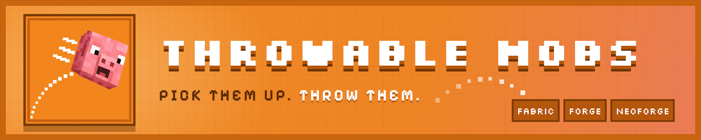
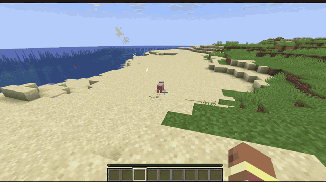
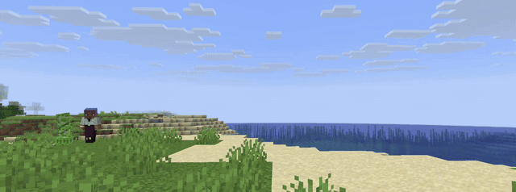

<p align="center">
  
</p>

<p align="center">
  Pick up mobs and throw them. Creepers explode on impact, endermen blink away, slimes bounce and split, chickens float.
  Catch your friends' throws mid-air.
</p>

<p align="center">
  <a href="https://github.com/SafetImamovic/ThrowableMobs/actions/workflows/release.yml"></a>
  <a href="https://www.curseforge.com/minecraft/mc-mods/throwablemobs"></a>
  <a href="https://github.com/SafetImamovic/ThrowableMobs/releases"></a>
  <a href="https://safetimamovic.github.io/ThrowableMobs/"></a>
  <a href="LICENSE"></a>
  <a href="https://ko-fi.com/safetimamovic"></a>
  <a href="https://github.com/sponsors/SafetImamovic"></a>
</p>

<p align="center">
  <a href="https://modrinth.com/mod/throwablemobs"><b>Download on Modrinth</b></a> ·
  <a href="https://www.curseforge.com/minecraft/mc-mods/throwablemobs"><b>Download on CurseForge</b></a> ·
  <a href="https://github.com/SafetImamovic/ThrowableMobs/releases"><b>GitHub releases</b></a> ·
  <a href="https://safetimamovic.github.io/ThrowableMobs/"><b>Docs</b></a> ·
  <a href="CHANGELOG.md"><b>Changelog</b></a> ·
  <a href="https://github.com/SafetImamovic/ThrowableMobs/issues/new/choose"><b>Report a bug</b></a> ·
  <a href="https://ko-fi.com/safetimamovic"><b>Support on Ko-fi</b></a>
</p>

Minecraft Java **1.20.1**, **1.21.1** and **26.3** · **Fabric**, **NeoForge** and **Forge** (1.20.1) · MIT · **Beta**

<p align="center">
  
</p>
<p align="center">
  
</p>

## Requirements

Install on both the client and the server. Optional mods are client only.

| | Minecraft 1.20.1 | Minecraft 1.21.1 | Minecraft 26.3 |
|---|---|---|---|
| **Fabric, required** | [Fabric Loader](https://fabricmc.net/use/) 0.15.0+<br>[Fabric API](https://modrinth.com/mod/fabric-api) 0.92.0+<br>[Forge Config API Port](https://modrinth.com/mod/forge-config-api-port) 8.0.0+ | [Fabric Loader](https://fabricmc.net/use/) 0.16.0+<br>[Fabric API](https://modrinth.com/mod/fabric-api) 0.109.0+<br>[Forge Config API Port](https://modrinth.com/mod/forge-config-api-port) 21.1.0+ | [Fabric Loader](https://fabricmc.net/use/) 0.19.5+<br>[Fabric API](https://modrinth.com/mod/fabric-api)<br>[Forge Config API Port](https://modrinth.com/mod/forge-config-api-port) 26.3.1+ |
| **NeoForge, required** | [NeoForge](https://neoforged.net/) 47.1+ (use the Forge jar) | [NeoForge](https://neoforged.net/) 21.1.197+ | [NeoForge](https://neoforged.net/) 26.3.0.95+ |
| **Forge, required** | [Forge](https://files.minecraftforge.net/) 47.1+ | — | — |
| **Optional** (every loader) | [YACL](https://modrinth.com/mod/yacl) 3.6.6+: the only settings screen on 1.20.1 | [YACL](https://modrinth.com/mod/yacl) 3.8.2+: a nicer settings screen | [YACL](https://modrinth.com/mod/yacl) 3.9.7+: a nicer settings screen |
| **Optional** (NeoForge) | — | [Ragdollified](https://modrinth.com/mod/ragdollified) 1.1.1+: thrown mobs go limp in the air | [Ragdollified](https://modrinth.com/mod/ragdollified) 1.1.1+ (its 26.3 build doesn't load yet) |

### Tested with

| Mod | Minecraft | Loader | Result |
|---|---|---|---|
| [YACL](https://modrinth.com/mod/yacl) 3.8.2 | 1.21.1 | Fabric, NeoForge | Works: the settings screen is YACL's |
| [YACL](https://modrinth.com/mod/yacl) 3.9.7 | 26.3 | Fabric, NeoForge | Works. On NeoForge, a warning about YACL's `logoFile` shows at startup; that's YACL's own metadata ([fix pending](https://github.com/isXander/YetAnotherConfigLib/pull/359)), click Proceed |
| [Carry On](https://modrinth.com/mod/carry-on) | 26.3 | Fabric | Both default to Left Shift + Right Click. Throwable Mobs no longer yields shared keys; compatibility needs retesting |
| [Carry On](https://modrinth.com/mod/carry-on) 2.12.0 | 26.3 | NeoForge | Carry On itself doesn't load on NeoForge 26.3 (its own bug) |
| [Ragdollified](https://modrinth.com/mod/ragdollified) 1.1.1 | 1.21.1 | NeoForge | Works: thrown mobs ragdoll in the air (setting `ragdoll_in_flight`), and a mob killed by a throw keeps its ragdoll and the throw's momentum |
| [Ragdollified](https://modrinth.com/mod/ragdollified) 1.1.1 | 26.3 | NeoForge | Ragdollified itself doesn't load on NeoForge 26.3.0.95 (its own bug) |

Found a mod that doesn't work with it? [Open an issue](https://github.com/SafetImamovic/ThrowableMobs/issues).

Design, physics model, behavior API and roadmap: [THROWABLE_MOBS.md](THROWABLE_MOBS.md).

## What it does

- **Carry:** pick up a mob, carry it on your head, put it down where you look. Heavy mobs slow you down; bosses and pets
  that aren't yours stay put.
- **Throw:** hold Throw to charge (charge bar like a bow) with a trajectory preview that shows exactly where the mob will
  land, bounces included. Light mobs fly far, heavy ones barely leave your hands. Sprinting adds to the throw, Strength
  makes it harder.
- **Impacts:** damage from collision energy, split by mass between the mob and what it hits, with knockback. Kills
  credit the thrower.
- **Catch:** grab a thrown mob out of the air; an outline shows which ones you can catch. Your own throw only after it
  bounces.
- **Mob behaviors:** creepers explode, endermen teleport and come for you, slimes and magma cubes bounce and split,
  blazes and magma cubes set things on fire, chickens float, lay eggs and scream when a monster is near. Modded mobs act like the vanilla mob they're
  built on.
- **Effects:** sounds, particles, a flight trail, and 8 advancements in their own tab.
- **Data-driven:** every behavior and number is set per mob in datapack mob profiles, or globally in the config. Other
  mods can add their own behaviors through a Java API.

## Controls

All rebindable under Controls → Throwable Mobs, or with `/throwablemobs keybinds`.

| Action | Default |
|---|---|
| Pick up / put down | Left Shift + Right Button |
| Throw (hold to charge, let go to throw) | Right Button while carrying |
| Cancel throw | Left Button while charging |

Shared bindings do not disable Throwable Mobs. If another mod also handles the same input, rebind either mod to
give each its own controls. When Carry On is installed, a chat notice explains the shared defaults once per world join.

Picking up, carrying on foot and throwing add small hunger costs in survival. Server settings in `[hunger]` control
each exhaustion cost; set them to `0` to disable them. See [server config](docs/guide/server-config.md#hunger-costs-hunger).

## Commands

| Command | Who | What |
|---|---|---|
| `/throwablemobs help` | Everyone | Lists these commands |
| `/throwablemobs config` | Everyone | Opens the settings screen |
| `/throwablemobs keybinds` | Everyone | Opens Controls to rebind the keys |
| `/throwablemobs profile <mob>` | Operators | Shows a mob's profile and where each value comes from |

## Configuration

- `config/throwablemobs-server.toml`: gameplay, synced from the server (throw strength, bounciness, damage, behaviors,
  what happens to carried mobs when players leave). Every setting:
  [Server config](https://safetimamovic.github.io/ThrowableMobs/guide/server-config).
- `config/throwablemobs-client.toml`: personal (prompt, charge bar, carry info panel, trajectory style, flight pose),
  editable in game.
- Datapacks: tags and mob profiles per mob, reload with `/reload`. Check a mob with `/throwablemobs profile <mob>`.

Guide for pack devs and mod devs: [safetimamovic.github.io/ThrowableMobs](https://safetimamovic.github.io/ThrowableMobs/)
(source in [docs/guide](docs/guide/README.md)).

## Issues and ideas

- Bugs and crashes: [open a bug report](https://github.com/SafetImamovic/ThrowableMobs/issues/new/choose) with your
  `latest.log` uploaded to [mclo.gs](https://mclo.gs).
- Ideas for features or mob behaviors are welcome too; the issue form asks what the mob should do.
- Changes per version: [CHANGELOG.md](CHANGELOG.md).

## Building

Requires JDK 25.

```sh
./gradlew build                     # jars in fabric/versions/<mc>/build/libs and neoforge/versions/<mc>/build/libs
./gradlew :physics:test             # unit tests
./gradlew :fabric:26.3:runClient         # dev client (Fabric)
./gradlew :neoforge:26.3:runClient       # dev client (NeoForge); :neoforge:26.3:runClient2 for a second one
./gradlew :fabric:26.3:runServer         # dedicated server
./gradlew :fabric:26.3:runClient --debug-jvm   # wait for a debugger on port 5005
```

## Layout

| Module | Contents |
|---|---|
| `physics/` | Pure-Java physics math (mass, launch, flight, bounces, impact). No Minecraft imports; unit tested. |
| `common/` | Almost all code. Compiles against vanilla only. Public API in `api/`. |
| `fabric/` | Fabric entrypoint and Fabric-specific glue. |
| `neoforge/` | NeoForge entrypoint and NeoForge-specific glue. |
| `build-logic/` | Shared Gradle conventions. |

Loader-specific calls from `common` go through `platform/Services` (Java `ServiceLoader`).

## Contributing

See [CONTRIBUTING.md](CONTRIBUTING.md): short branches off `master`, atomic Conventional Commits, PRs against `master`.

Based on [MultiLoader-Template](https://github.com/jaredlll08/MultiLoader-Template).
